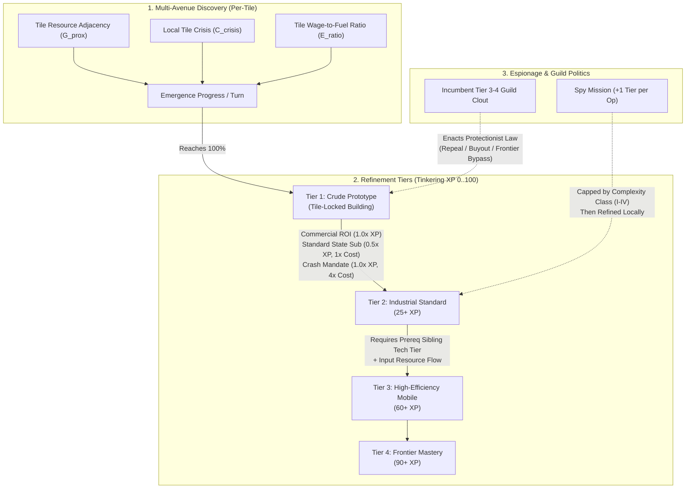

# Integration Plan: Emergent Multi-Avenue Tech Tree, Refinement Tiers & Guild Leapfrogging

**Target System:** `macro/innovation.py`, `trace/innovation_trace.py`, `macro/construction_politics.py`, `client/worldview/worldview_science_panel.py`, `web_client/client.js`, and `client/web/tech_sim_server.py`.  
**Design Reference:** `planning/emergent_tech_tree_integration_plan.md` & Standalone Interactive Simulator (`tech_sim_web.py`).

---

## 1. Architectural Overview & Conservation Guarantees

Currently, [`macro/innovation.py`](file:///Users/sli/Code/macro/innovation.py) models technology as a single-stage probabilistic roll once `domain_experience * bottleneck_pressure >= base_xp_required`, with a single `bottleneck_evaluator` per tech and binary adoption (`tech_id in discovered_techs`).

To integrate the **Needham Question / Great Divergence** mechanics into **Call of Capital** while strictly preserving **penny-exact monetary and physical conservation** (`0 LEAK / 0 SHIFT`) and **100% Causal Trace coverage**, the upgrade is divided into 6 modular phases:



---

## 2. Phase-by-Phase Implementation Plan

### Phase 1: Data Model Expansion in `macro/innovation.py`

1. **`ComplexityClass` Enum & Espionage Caps:**
   Add complexity classes governing how close espionage or passive trade diffusion can bring a follower to the leader before domestic refinement must take over:
   * `CLASS_I_LOW` (Era 1 — e.g., `crop_rotation`, `bloomery_iron`, `gunpowder_blasting`): Max Stolen = `Source Tier - 0.5` (`85 XP` cap).
   * `CLASS_II_MEDIUM` (Era 2–3 — e.g., `coal_coking`, `steam_engines`, `mechanized_looms`): Max Stolen = `Source Tier - 1` (`65 XP` cap).
   * `CLASS_III_HIGH` (Era 3–4 — e.g., `bessemer_steel`, `petroleum_refining`, `dynamo_electrification`, `synthetic_fertilizers`): Max Stolen = `Source Tier - 1.5` (`50 XP` cap).
   * `CLASS_IV_EXTREME` (Era 4 — e.g., `microelectronics`, `pharmaceutical_chemistry`): Max Stolen = `Source Tier - 2` (`30 XP` cap).

2. **`DiscoveryAvenue` Dataclass:**
   Replace the single `bottleneck_evaluator` with a list of `DiscoveryAvenue` objects on each `Technology`:
   ```python
   @dataclass
   class DiscoveryAvenue:
       avenue_id: str
       name: str
       required_resources: list[TileResource]
       prototype_building: str
       crisis_evaluator: Callable[[Region, Nation], tuple[float, dict]]
   ```
   * **Example (`steam_engines`):**
     * `pit_drainage`: `COAL_SEAM` + Deep Mine Flooding (`region.mine_depth >= 3` and `region.rainfall >= 0.5`) → unlocks `atmospheric_pump` (tile-locked to coal/iron mines).
     * `blast_bellows`: `IRON_ORE` + `COAL_SEAM` + Low river flow / winter freeze → unlocks `steam_blast_furnace`.
     * `polder_drydock`: Coastal/Marsh tile or `naval_dockyard` + fuel access → unlocks `hydraulic_sluice_pump`.
     * `brine_sugar_boiler`: High-volume food/salt/sugar refining + copper/iron → unlocks `condensing_boiler`.
     * `upstream_barge`: Navigable river edge with high upstream freight friction → unlocks `steam_winch_barge`.

3. **`RefinementTierSpec` & Cross-Tech Tier Dependencies:**
   Extend `Technology` with `tier_thresholds = {1: 1.0, 2: 25.0, 3: 60.0, 4: 90.0}` and `tier_dependencies: dict[int, dict[str, int]]`:
   * **Tier 1 (`1–24 XP`):** Unlocks only the tile-locked prototype building (high fuel input, low efficiency).
   * **Tier 2 (`25–59 XP`):** Unlocks city-wide stationary industrial buildings (e.g., `textile_mill`, `river_steamboat`).
   * **Tier 3 (`60–89 XP`):** Unlocks mobile/high-pressure applications (e.g., `railroad`, `bessemer_steel` rails). Hard-gated by `tier_dependencies` (e.g., `steam_engines` cannot advance past `59 XP` until `coal_coking` and `bloomery_iron` are at least Tier 2).
   * **Tier 4 (`90–100 XP`):** Unlocks maximum production modifiers and grid-scale buildings.

---

### Phase 2: Emergence & Factor-Price Engine (`macro/innovation.py`)

In `InnovationSystem.evaluate_breakthroughs(nations, t)`:
1. **Per-Tile Adjacency Score ($G_{\text{prox}}$):**
   * `4.0x` if required avenue resources exist on the same `Region` tile or an adjacent water/canal-connected `Region` owned by the nation.
   * `1.0x` if connected via passable road edge within 2 hops.
   * `0.2x` if landlocked/distant or only available via expensive overland caravan imports.
2. **Wage-to-Energy Factor Price Ratio ($E_{\text{ratio}}$):**
   * Compare tile average worker wage (`avg_wage`) against local fuel price (`coal`/`wood` market price on tile):
     $$E_{\text{ratio}} = \text{clamp}\left(\frac{\text{avg\_wage}}{\max(0.5, P_{\text{fuel}})}, 0.2, 4.0\right)$$
   * High wages + cheap local fuel yield up to `4.0x` commercial emergence speed; cheap peasant labor + expensive fuel yields `0.2x`, naturally reproducing the Robert Allen / Needham divergence.
3. **"Ghost Acres" Throughput Multiplier ($S_{\text{supply}}$):**
   * Measure raw material import volume (`cotton`, `wool`, `timber`, `iron_ore`) flowing into manufacturing tiles from external regions/colonies. High external input volume multiplies Refinement XP by up to `3.0x` without consuming domestic arable grain land.

---

### Phase 3: Conserved State Subsidies vs. Commercial Operation

Players governing low-wage empires (or attempting latecomer catch-up) can set a technology's operating mode via `InnovationSystem.set_subsidy_mode(nation, tech_id, mode)`:

| Mode | Treasury Cost | Refinement XP Multiplier | Conserved Money Flow (`StateMutationHandler`) |
| :--- | :---: | :---: | :--- |
| `'commercial'` | `$0` | `1.0x * (E_ratio / 2.0)` *(Stalls if `E_ratio < 0.8`)* | Funded organically by private factory/building profits on the tile. |
| `'standard'` | `1x Base ($25/t)` | `0.5x Base XP` *(Half speed)* | `nation.government.agent.cash` $\rightarrow$ distributed pro-rata to artisan/worker `Person.cash` on the prototype tile via `begin_public_change` / `finish_public_change`. |
| `'crash'` | `4x Base ($100/t)` | `1.0x Full Adjacency Speed` | `nation.government.agent.cash` $\rightarrow$ distributed pro-rata to artisan/engineer `Person.cash` and local supplier orders (`0 LEAK`). |

---

### Phase 4: Incremental `+1 Tier` Espionage & Local Refinement

Add `InnovationSystem.attempt_espionage(stealer: Nation, target: Nation, tech_id: str, t: int) -> dict`:
1. **Validation Gates:**
   * Target nation must have a higher Tier in `tech_id` than `stealer`.
   * `stealer` must possess the physical input resources (`get_nation_resources(stealer)`).
   * If advancing to `current_tier + 1` requires a prerequisite sibling tech at Tier $K$ (`tier_dependencies`), `stealer` must already have that prerequisite tech at Tier $\ge K$ (or steal the prerequisite first!).
2. **Complexity Ceiling Check:**
   * Calculate `max_steal_xp = target_xp * COMPLEXITY_CAP[tech.complexity_class]`.
   * If `stealer_xp >= max_steal_xp`, the spy mission is blocked with reason `'espionage_complexity_ceiling_reached'`.
3. **Conserved Execution & Local Refinement Hand-Off:**
   * Deduct spy mission cost (`$150`) from `stealer.government.agent.cash` and transfer to operative/informant agents (`0 LEAK`).
   * Advance `stealer`'s `tech_refinement_xp[tech_id]` to the floor of `current_tier + 1` (capped at `max_steal_xp`).
   * **Crucial Hand-Off:** Once stolen to the ceiling (e.g., Tier 2 for `microelectronics`), `stealer` can construct Tier 2 buildings on its own tiles and accumulate **domestic Refinement XP** via Phase 2/3 all the way to Tier 4!

---

### Phase 5: Entrenched Guild Legislative Blockades (`macro/construction_politics.py`)

1. **Incumbent Clout Calculation:**
   * Each operating Tier 3–4 building from an older paradigm (e.g., `fluvial_watermills`, `workshop`, `turnpike_road`, `barge_canal`, or `steam_engines` when transitioning to `petroleum_refining`/`dynamo_electrification`) contributes **Sector Clout** proportional to its share of national building revenue and employed citizens.
2. **Automatic Protectionist Legislation:**
   * When a disruptive successor tech reaches Tier 1 while incumbent clout exceeds `30%`, an `IncumbentProtectionLaw` (e.g., *Guild Charter Monopoly*, *Locomotive Red Flag Act*, *Right-of-Way Veto*) is automatically enacted.
   * **Mechanical Effect:** Prototypes of the new tech cannot be built in tiles containing the incumbent guild's buildings, and national Refinement XP for the new tech is throttled to `0.25x`.
3. **Three Conserved Countermeasures:**
   * **Parliamentary Repeal:** Costs Political Capital / Legitimacy (`-0.12 legitimacy`) and triggers a 5-turn Guild Strike on legacy buildings (`unrest.py`), immediately lifting the blockade.
   * **Eminent Domain Buyout:** Transfers `$400` from `nation.government.agent.cash` directly to the owners/shareholders of the legacy guild buildings (`0 LEAK`), retiring the protectionist charter peacefully.
   * **Greenfield Frontier Bypass:** Player constructs the new prototype on a frontier or newly developed `Region` tile that has zero legacy guild buildings (`0% local guild clout`), bypassing the law without spending gold or legitimacy!

---

### Phase 6: Causal Trace, UI Parity & Mandatory Tech Simulator Sync

1. **Causal Trace (`trace/innovation_trace.py`):**
   * Record `innovation_avenue_evaluation`, `innovation_refinement_xp_update`, `innovation_subsidy_transfer`, `innovation_espionage_step`, and `innovation_guild_blockade` in `.ctr` trace files so the UI's *"Why did this change?"* inspector shows exact mathematical evidence.
2. **Desktop (`client/worldview/worldview_science_panel.py`) & Web (`web_client/client.js`) Parity:**
   * Update Suite 5 (`🔬 Science & Tech Tree`) to display active Discovery Avenues, the `0–100 XP` Refinement progress bar with Tier 1–4 ticks, Subsidy Mode buttons, `+1 Tier Steal` button, and Incumbent Guild Legislation cards.
3. **Mandatory Synchronization with the Standalone Tech Simulator (`client/web/tech_sim_server.py`):**
   * **Hard Engineering Rule:** Whenever any technology, discovery avenue, refinement threshold, espionage cap, or guild rule is added or modified in `macro/innovation.py`, the standalone **Tech Tree & Leapfrog Simulator** (`client/web/tech_sim_server.py` / `tech_sim_web.py`) **must** be updated in the same commit, and verified via `tests/test_tech_sim_server.py`.
