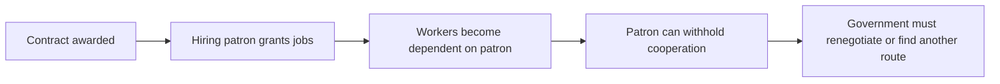

# Patronage, brokers and captured government: implementation plan

Date: October 29, 2026.
Status: first bounded implementation completed October 29, 2026. See the [play guide and winning routes](../docs/people_network_patronage.md) and [verification report](reports/people_network_patronage.md). The specification below records the design; implemented scope and remaining limits are in the report. Existing [version-2 coalition rules](people_network_coalition_mechanics.md) remain available as the classic ruleset.

Direction update, October 30: the [Governing through society plan](governing_network_implementation_plan.md) supersedes integrating this laboratory's complete player-facing loop into the main game. The experiment remains useful evidence; the next proposal removes recurring individual recruitment and reuses existing campaign resources and institutions.

## 1. Intended player experience

The player bargains with people who can deliver cooperation, appointments, jobs or obstruction. A representative may gain personally while their constituents suffer. A favor can secure cooperation now and strengthen a future rival. Completing the bridge can end someone's useful temporary authority. Holding office, delivering effective government and improving people's lives are distinct outcomes.

A concrete first sequence should be possible:

1. A trader offers to manage the repair in exchange for the contract and a temporary toll concession.
2. A craft organizer seeks control over hiring. Jobs benefit some followers and exclude others, increasing both their following and resentment.
3. The farmer representative accepts a personal toll exemption while ordinary farmers still pay. Their council vote may be secured while their ability to rally farmers deteriorates.
4. The player can instead negotiate public management, broad hiring and affordable access, building cooperation through different relationships and obligations.
5. After completion, a contractor may still control the toll concession, a hiring patron may have acquired followers, and excluded people may organize with Sen. Displacement does not reset these interests or rights.

This should emerge from identifiable choices and transactions. Do not implement a generic corruption meter, a universal bribe button, or a global penalty that substitutes for explaining who was helped or harmed. Actors should have varied motives; some offers should be refused even when profitable.

## 2. First playable scope and delivery order

Keep the same terrain catchment, 32 named people, nine-person council, four organizations, two action points, current fatigue rules and four recurring service shares. Add a separate Patronage scenario/ruleset selectable at creation. The current coalition scenario remains a baseline.

The smallest useful slice is **one bridge contract, one hiring office, and one time-limited access concession**. Include a public-management alternative, personal versus constituent interests, finite payments, broker dependence and an individually explainable delivery failure. Public and private promises plus exposure follow after those foundations work.

Do not begin with national procurement, many commodities, political parties, procedural institutions, warfare, assassination, a news/media simulation or a full financial economy. Broader emergency powers, fabricated crises and coercive policing require subsequent designs. The first slice can already make delay politically useful through a temporary project office that expires on completion.

The stages below distinguish what must ship first from later work. Do not merge a collection of inactive records and call the patronage scenario playable.

## 3. Distinguish interests, cooperation and allegiance

### People and representatives

Retain the pressure graph and individual ballots. Add authored personal priorities for each significant broker: personal income, control over appointments/jobs, public delivery, constituency welfare, loyalty and reputational exposure. Priorities differ by person and can conflict. Use three or four exposed motives per major actor, not a large personality inventory.

A group representative is a person with a role and followers, not the group's collective mind. A contract with that person can bind their own resources, office and promised effort. It cannot automatically commit all members. Followers judge jobs, access, treatment and observed conduct individually, alongside existing relationships and interests.

The current `coalitions.failed_conditions()` can gate every member of an organization after a group agreement breaches. For Patronage, replace that broad assumption with explicit consenting signatories and the scope of authority they delegated. Preserve the original rule in the classic ruleset. Distinguish an organization's public agreement from a representative's private bargain.

### Cooperation has several meanings

Keep political preference, declared backing, task participation and council ballots distinguishable. A worker may accept a job from a patron and vote against the patron's preferred candidate. An actor may carry out an order because their livelihood depends on the officeholder while trusting that person very little.

Add dependence/obligation as a relationship dimension where a recorded job, payment or control right supports it. Use it in the relevant request/effort decision with a stated cost of refusal. Do not substitute dependence for trust in the existing diffusion equation or make employment automatically deliver votes.

A broker's promised following is an estimate from reachable people, contextual trust, actual dependence, available effort and competing commitments. Display who they can reasonably approach and verify who actually responds. A broker who loses followers cannot keep delivering an obsolete advertised bloc.

For each offer or cooperation decision, compare the actor's known benefits and costs with their available alternative: another job, independent work, another patron or refusal. Use bounded, inspectable motive contributions and stable tie-breaking. Keep financial constraints separate from this preference calculation. A favorable score cannot authorize an unaffordable transfer or override another person's refusal.

## 4. Leverage through limited institutional rights

Add three explicit rights, with one authoritative holder and a defined scope:

| Right | Powers in the first slice | Limits and expiry |
|---|---|---|
| Repair contract | Propose a recruitment/work plan; receive authorized milestone payments; request cooperation | Fixed escrow ceiling, verified work milestones, defined cancellation terms |
| Project hiring office | Offer available job slots and prioritize eligible applicants within the contract's rules | Cannot create workers or effort; expires on completion or lawful removal |
| Access concession | Collect the authorized toll from actual users and honor recorded exemptions | Fixed term, fee ceiling and revocation/compensation conditions |

Attach each right to an institution/project and a named person, public board or organization. A role can persist when the ruler changes. Rights confer specific command permissions rather than an abstract boost to influence.

Maintain a small **control graph** alongside the social graph: holder → right → task or access gate. It is a different relation type, not another region-by-region people graph. Use it to answer who can block the next step and which substitutes exist. Mark these rights and gates visibly on the terrain and network views.

Retain gradual pressure propagation on the social graph. Use directed reachability for invitations and disclosures, and dependency traversal for project gates and alternative routes. Job/dependence edges change through actual delivery and expiry. Pressure can spread support across a boundary over several rounds; a legal permission still changes only through an authorized decision. Do not collapse these different mechanisms into one edge weight or apply social diffusion to ownership.

Withholding must obstruct something the actor controls. A hiring officer can refuse to dispatch their queue, but cannot forbid every independent worker from helping. A contractor can withhold their contracted service, but an alternative public route can exist with explicit action, time or compensation costs. Do not grant universal vetoes because someone has a high centrality score.

## 5. A bounded ledger for real benefits

Private gain must come from a recorded transfer or enforceable right. Use a small conserved laboratory credit ledger for this scenario. These credits do not represent existing national cash or reuse service shares as money.

Proposed initial fixture: 36 credits in the public Bridge Fund and four credits held by each of the 32 people, for a fixed initial total of 164. These are tuning defaults. Keep the existing four service-budget shares as a recurring allocation constraint, clearly labeled separately. Do not silently convert shares into personal cash.

Tie payments to the existing work requirement: six workers and four haulers over three successful work rounds require up to 30 one-credit labor payments. A contractor's proposed 36-credit package can include those payments plus a six-credit management margin. Public management can pay the same labor directly and retain the unspent margin. Public management still needs actual consent, administrative work and cooperation; the contractor may provide those through existing relationships.

All labor, fees, rents, tolls, rebates, compensation and refunds transfer credits between named accounts. Escrow remains owned and counted until disbursed; avoid counting it twice. No negative wallets or unsecured credit. Unaffordable tolls cause a blocked/deferred crossing or an authorized exemption, not invisible debt or invented revenue.

Toll demand comes from a small authored travel schedule for actual people. Log who needed to cross, what they paid, who received it and who could not cross. Do not generate a free income stream because a toll right exists. Cap early toll duration and demand to keep the laboratory bounded.

The ledger has ordinary transfer invariants and semantic event references. It must remain isolated from full-game financial accounts. Later integration must replace this fixture funding with existing money/accounting adapters rather than running two authorities for the same wealth.

## 6. Work and contract delivery

Retain one effort slot per person. Political organizing, paid repair work and other task commitments compete for that slot. Payment does not duplicate effort or guarantee acceptance.

Represent job offers explicitly: employer/hiring holder, worker, required skill, duration, wage, funding reservation and conditions. Accepting an offer creates a commitment; each work round still validates availability, fatigue rules where applicable, competing obligations and the job's funding. Only delivered contributions advance the bridge.

Keep a single authority for repair progress. A contract or hiring office supplies validated contributors to the existing work/project resolver; it does not operate a second construction counter. Public/direct contributors and contracted contributors are deduplicated by person and round.

Account for unsuccessful work rounds and later maintenance explicitly. The initial 30-credit labor estimate covers three successful rounds; a broken work streak can consume funds without completing the repair. Show the remaining affordable work before accepting a proposal. Any additional work or maintenance needs actual voluntary effort or an identified payer, including authorized toll receipts. Insolvency, suspension and unfinished repair are valid outcomes; no hidden refill rescues a contract.

Contract payments must distinguish earned labor payments from the management margin. Make any retainer explicit, capped and escrow-funded. Keep at least part of the margin payable on completion so the contractor may want completion while a temporary hiring patron may prefer continued authority.

The hiring office expires when the repair completes, with a visible transition. That makes delay potentially useful to its holder. An intentional pause or withheld authorization is a traceable decision with effects on wages, public access, deadlines and the holder's influence. Do not pay an infinite retainer for doing nothing.

## 7. Patronage creates durable power and risk

An actual job, exemption or payment can establish an obligation/dependence edge toward the person who controls that benefit. The strength should reflect recent delivery, expected continuation, alternatives and the cost of refusal. It must be bounded and decay or change when the benefit ends. Do not add permanent loyalty for merely signing a contract.

Separate who is credited: workers may credit the hiring patron for their jobs while the government pays the bill. This attribution follows visible responsibility and known arrangements; it is not automatically assigned to the player. Beneficiaries can disagree about who deserves credit.

A broker who secures jobs may acquire more willing contacts and greater capacity to organize. Their rising influence can support the player, increase their demands, enable independent bargaining, or make them a credible ally for Sen. Derive this from jobs, relationships and cooperation, not a timer that guarantees betrayal.

A representative accepting a personal exemption can gain privately while losing credibility among members who pay. Losing trust need not remove dependence on jobs. Countervailing peer ties and an alternative organizer should allow a group to survive or replace its compromised representative.

Offer institutional choices that change this process: public hiring criteria, time limits, audits and revocable appointments. Each has administration or political costs and concrete powers. Do not award a moral bonus for selecting a cleanly labeled option. Public delivery, state capacity and personal survival should have distinct measures and occasionally conflict.

For Patronage, replace the existing project-wide adjustment to every outgoing incumbent trust link with attributed, person-specific reactions to observed delivery and costs. Preserve classic behavior in its ruleset. Completing the bridge should not automatically improve every relationship when some people lost jobs, access or authority as a result.

## 8. Public claims, private bargains and exposure

Introduce this after contract delivery works. Canonical truth, a person's knowledge and the player's knowledge are distinct. Begin with a narrow knowledge model rather than a general intelligence simulation:

- Public statements are known to the declared public audience.
- Private deal terms are known to their participants and specifically authorized officials.
- A person learns their own job terms, payment, toll charge, denied access or exemption through an actual event.
- An audit or an informed witness can expose a record along a specified disclosure path.

The player can make a public promise of affordable/free access while privately offering a toll concession or a personal exemption. The player's own interface displays their conflicting obligations. Patronage rules permit contradictory promises to be recorded; they do not permit double ownership of an exclusive right, spending nonexistent funds or impossible transfers.

Retain typed promises with issuer, beneficiaries, audience, terms, due conditions and fulfillment evidence. Detect a political contradiction for a person only when that person knows both relevant claims or experiences a breach. A public allegation without evidence is not automatically canonical truth.

First exposure case: farmers are charged despite a public promise of free access; payment/denial receipts provide evidence of the breach. The representative's private exemption is separately discoverable through an audit or an informed participant. Different people react according to interests, benefits, trust and evidence. Do not apply a uniform scandal penalty to the whole country.

Public-oversight appointments should confer actual access to records. An independent official may expose a deal even when doing so hurts the appointing ruler. Oversight that only functions when the player clicks it would miss the intended institutional tension.

## 9. Changes in government and playable outcomes

The council remains the legal route into office for this slice. Actors may obstruct project delivery without being able to overthrow the government. A ruler may remain in office while public access and repair performance deteriorate.

On displacement, preserve social ties, credit balances, earned wages, outstanding escrow, contracts, role holders, concessions, evidence and memories. Distinguish personal patronage from rights attached to office. The successor inherits lawful obligations and may honor, buy out, challenge or revoke them under declared rules. Revocation has explicit cost and consequences; it is not a free network reset.

The displaced player can organize through their remaining relationships and patronage, expose the incumbent's arrangements or assemble a different coalition. Restoration brings inherited contracts and earlier private promises back into governing decisions. A hiring patron or contractor must also be able to support Sen under the same rules available to the player.

Debrief at least three independent dimensions: public welfare/access, government delivery capacity and player/coalition power. Explain beneficiaries, excluded people, private rents, outstanding obligations and concentration of control. Avoid a single score that treats survival as proof of good government.

## 10. Interface and causal explanation

Keep the first screen concrete: “The bridge needs repair. Here are the offers, who controls the next step, who gains and who pays.” Show a few actionable proposals rather than asking the player to inspect all 32 motives.

Add project offer cards comparing public cost, labor, rights granted, personal beneficiaries, access terms and conditions that can fail. After acceptance, the card becomes an actual delivery/obligation tracker. Show a broker's own demands separately from their followers' interests and observed willingness to cooperate.

Keep governing choices within the existing two-action limit: propose/accept a bounded offer, award or lawfully replace an office, authorize a concession/exemption, or order an audit when available. Viewing terms and explanations is free. A hiring plan generates individual offers and responses without requiring the player to click every worker. Define which decisions belong to the player, a delegated holder or an autonomous worker; do not charge the player an action for every automatic job response. Ship basic offer and blocker views with the contract milestone, then refine them after the mechanics work.

The map should support a focused **Who can block this?** overlay: contract, hiring and access holders, relevant dependence links, alternative routes and affected communities. Distinguish trust arrows from job/payment/control relations by line style and labels. Thickness has a stated meaning within each relation type. A wealthy patron must not appear universally persuasive merely because their financial links are thick.

Show simple changes such as “Quinn now controls hiring for seven workers,” “three farmers could not afford the toll,” or “Yara's exemption is known to the auditors.” Full truth remains available in the developer inspector. Normal play must not leak undiscovered private terms through advice, colors, tooltips or unexplained rank changes.

Extend the existing causal record families rather than logging every graph edge each frame. Record accepted offers, right changes, transfers, job commitments/contributions, withheld actions, toll/denial evidence, disclosures and resulting allegiance/authority changes. Checkpoints retain gradual state. A useful chain is:

Each link needs recorded evidence. Distinguish a broker's promised followers from delivered cooperation. Exact arithmetic must reconcile transfers and effort. Explaining a transition is not proof that one broker was a necessary cause; use explicit replay branches for necessity claims.

## 11. Architecture and sequencing

Proposed files below are relative to the repository root. Reuse existing behavior where possible; confirm these boundaries before implementation.

| Area | Proposed change |
|---|---|
| `people_network/patronage.py` | Motive evaluation, broker commitments, earned dependence and benefit attribution |
| `people_network/institutions.py` | Rights, gate permissions, office expiry and alternative delivery routes |
| `people_network/contracts.py` | Offers, jobs, milestones, escrow obligations and concession terms |
| `people_network/accounts.py` | Conserved laboratory credits, reservations, payments and reconciliation |
| `people_network/knowledge.py` | Audience-scoped terms, observations, evidence and disclosure |
| `people_network/coalitions.py` | Retain classic behavior; Patronage uses explicit signatories and personal/constituency distinction |
| `people_network/engine.py` | Validated commands and one authoritative round order |
| `people_network/dynamics.py` | Retain pressure propagation; named new interest inputs only where justified |
| `people_network/events.py` | Typed semantic records and reconstruction for rights, transactions and knowledge |
| `people_network/advice.py` | Conditional offer comparisons with recorded knowledge and scope limits |
| `people_network/rival.py` | Sen's legal contract, appointment, disclosure and coalition choices using Sen's own knowledge |
| `people_network/scenario.py` | Ruleset selection and authored actor/offer/control fixtures |
| `client/desktop/network_lab.py`, `network_map.py` | Offer, beneficiary, blocker and obligation views |

Proposed resolution order: accept authorized declarations/reservations → deliver known messages and offers → resolve voluntary commitments and withholding → evaluate existing and new constraints → update interests and pressure → allocate unique effort and process funded work → pay earned claims and advance project once → process completion/office expiry, access/tolls and observations → disclose evidence due this round → update confidence and ballots → resolve office changes and persist. Define precisely which new information affects the current ballot versus the next pressure update. Use frozen phase snapshots and stable ordering throughout.

Do not infer institutional permission from social pressure. Enforce permissions before mutations; rejected commands must spend nothing. Give every right, agreement, payment and evidence record a stable ID, with references validated on load.

Extend the rival policy as each action family arrives. Sen and the player face the same action costs, permissions, finite funds and persistence rules. Brokers and officials also need deterministic autonomous choices within their roles, based on known alternatives and motives. They must be able to refuse, disclose, cooperate or withhold without the player directly commanding every outcome. Test these policies through complete runs rather than forcing betrayal or a government change at a chosen round.

## 12. Milestones and exit gates

| Milestone | Concrete deliverable | Gate |
|---|---|---|
| 1. Authority and interests | Scenario roles, personal versus constituent needs, control graph, permissions and rule/save contracts | A broker cannot bind nonconsenting followers or command unrelated resources; classic behavior remains available |
| 2. Contract and money | Funded public/merchant offers, ledger, escrow, hiring, unique work delivery and basic offer/blocker views | All credits and effort reconcile; both public and brokered routes can actually complete the bridge |
| 3. Patronage and dependency | Jobs/exemptions create bounded obligations; broker power and follower credibility can diverge | Private gain can coexist with constituent harm; patron loses delivery capacity when followers or alternatives change |
| 4. Delay and succession | Temporary office expiry, withheld cooperation, replacement/buyout, persistent rights after office changes | Delaying completion can preserve one actor's leverage and harm another; dependencies survive restoration without guaranteeing permanent capture |
| 5. Conflicting promises and evidence | Public/private terms, actual toll observations, limited audit/disclosure route | People react to what they know; evidence produces local, explained changes without omniscient advice |
| 6. Playable presentation and balance | Offer comparison, blocker overlay, independent outcome measures and short test sessions | Testers understand who benefits and why a broker can or cannot deliver; at least two materially different approaches are worth trying |

Milestones 1–4 produce the first publicly inspectable patronage slice. Milestones 5–6 complete the proposed first release. Keep detailed full-information diagnostics through early mechanical testing, then verify audience-specific views before presenting private bargains as a normal-play feature.

## 13. Verification and scenario acceptance

Add behavioral tests for permissions, unique rights and person/task allocation; exact initial endowment/escrow/wage/toll reconciliation; expired/revoked rights; finite demand and inability to pay; public versus private benefit; recipient-specific motive refusal; dependence without political endorsement; overlapping signatories; no automatic bloc voting; delivery claims checked against actual cooperation; and preservation through government changes.

Knowledge tests must reject reactions to undisclosed clauses, discover contradictions through real observations, enforce audit access, prevent advice/tooltip leaks and keep full developer truth separate. Trace tests must reconstruct the actor, funds, authority and knowledge needed for an inflection, with identical traced/untraced authoritative results and save/resume replay.

Check at least these legal playthroughs, without scripted office transfers:

- A public-management route completes the bridge and builds cooperation with limited personal control.
- A patronage route improves near-term political control while enriching a broker and imposing access costs.
- A deal with a representative fails to mobilize the promised followers.
- A hiring patron gains followers and later bargains independently or supports Sen when a viable incentive exists.
- Government survives despite poor public delivery; a separate run improves public delivery while weakening the ruler's control.
- Exposure changes support through people who received evidence, with beneficiaries and harmed people reacting differently.
- Displacement/restoration preserves enforceable concessions, obligations and remembered deals.

Record public and private accounts, completed work/access, actor dependence, support, control rights, evidence reach, office changes, trace size and step/forecast time. Do not require corruption to win or the public route to dominate. If the trade-off is invisible or a single bribe solves every case, revise the mechanics before adding more institutions.

## 14. Compatibility and first implementation step

Select the ruleset at scenario creation, not with a mid-run live toggle. Preserve version-2 laboratory runs and their deterministic fixture as a classic baseline. At milestone 1, decide and test explicit save envelopes: support version 2 as classic with its original fields, and use a distinct version-3 Patronage schema. Refuse implicit conversion into patronage state. Do not rewrite classic state or consume additional RNG draws when the new ruleset is disabled.

The implementation began with milestone 1 and a headless offer/permission fixture, then added the playable interface and evidence rules. The current [verification report](reports/people_network_patronage.md) records delivered behavior and acceptance evidence. Economic integration and a generalized political system remain separate work.
