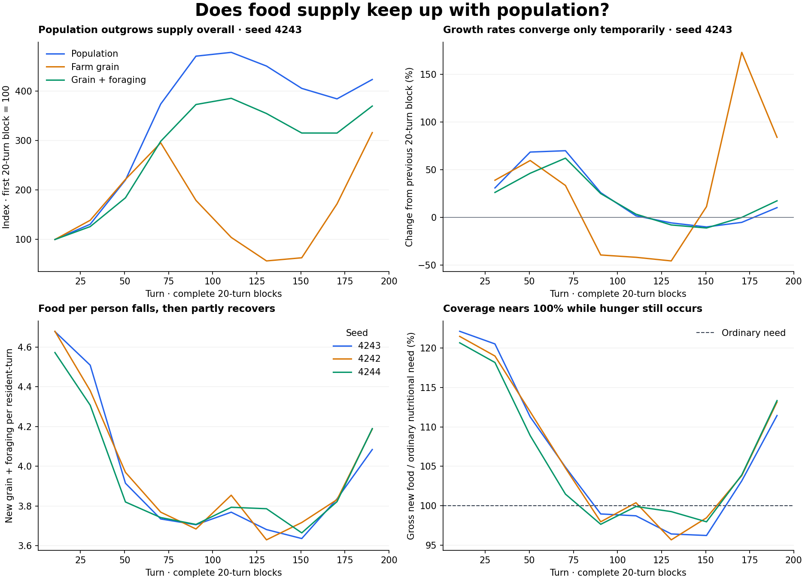

# Population and food growth review

Date: 2026-11-01.

Equal growth is a useful long-run condition for stable food per person. Reaching abundance first requires food to outgrow nutritional demand, creating a dependable surplus and accessible reserves. Later, population, diet, processing and exports can absorb part of that surplus. Exact equality every turn is neither required nor a target to hard-code.

This report reanalyzes the frozen 2026-10-31 campaigns. It does not represent a fresh run of the newer seasonal-farm implementation now in the workspace. The archived simulation source fingerprint and each input file hash are preserved in `growth_trends.json`.

## Measurement

- Compare nonoverlapping twenty-turn averages, each spanning two complete seasonal cycles. Never compare a harvest turn directly with a sowing turn.
- Track population, farm grain, total new food (grain plus actual foraging), and ordinary nutritional demand separately. Prepared-food output converts existing grain; it adds no new calories.
- Growth rates are percentage changes between adjacent block means. Population and food indices share their first complete block as 100.
- Food per resident-turn is total new food divided by the sum of residents over the block. Ordinary-demand coverage allows for changing age composition.
- Seeds and storage losses are deducted when recorded. They are unknown in the archived fixture, so the coverage below is explicitly gross. Imports, exports and drawdown of existing stocks are additional flows, not new local production.
- Near alignment means food per person changes by at most 2% between blocks. The descriptive sustained test requires three consecutive comparisons with nonnegative population and food growth. This is a reporting convention, not a demographic constraint, and it is not evidence of household access.

## First versus last twenty-turn blocks

| Seed | Population growth | Farm grain growth | Grain + foraging growth | Food per resident-turn | Ordinary-demand coverage | Longest near-aligned growing streak |
| --- | ---: | ---: | ---: | ---: | ---: | ---: |
| 4243 | +324% | +216% | +270% | 4.68 → 4.08 | 122% → 111% | 2 comparisons |
| 4242 | +398% | +320% | +346% | 4.68 → 4.19 | 121% → 113% | 0 comparisons |
| 4244 | +349% | +248% | +312% | 4.57 → 4.19 | 121% → 113% | 1 comparisons |

Food per person finishes below its opening level in all three seeds. None meets the three-comparison sustained growing-alignment criterion. Their late recovery is useful evidence, but it does not establish a stable productive surplus.

## Seed 4243 timeline

| Turns | Population growth | Farm grain growth | Grain + foraging growth | Food/person | Ordinary need covered | Underfed share |
| --- | ---: | ---: | ---: | ---: | ---: | ---: |
| 1–20 | — | — | — | 4.68 | 122.1% | 3.3% |
| 21–40 | +30.8% | +38.9% | +26.1% | 4.51 | 120.5% | 4.6% |
| 41–60 | +68.4% | +59.6% | +46.2% | 3.91 | 111.3% | 0.5% |
| 61–80 | +69.8% | +33.4% | +62.0% | 3.74 | 104.9% | 0.2% |
| 81–100 | +25.9% | -39.4% | +24.9% | 3.71 | 99.0% | 10.8% |
| 101–120 | +1.6% | -41.8% | +3.4% | 3.77 | 98.7% | 8.0% |
| 121–140 | -5.8% | -45.6% | -8.0% | 3.68 | 96.4% | 9.5% |
| 141–160 | -10.0% | +11.3% | -11.1% | 3.64 | 96.2% | 10.3% |
| 161–180 | -5.2% | +172.8% | -0.0% | 3.84 | 103.2% | 8.7% |
| 181–200 | +10.2% | +83.8% | +17.3% | 4.08 | 111.4% | 3.4% |

In turns 81–100, population grows 25.9% and grain-plus-foraging grows 24.9%, but farm grain falls 39.4%. Underfeeding is 10.8% and gross production covers about 99% of ordinary need. Apparent alignment is driven by subsistence gathering, not agricultural productivity. The old foraging rule supplies eligible adults with up to four food units each turn, making supply rise mechanically with eligible adults.

In the last comparison, population grows 10.2% while total food grows 17.3% and farm grain grows 83.8%. Food is catching up again. More than one recovering block is needed to establish stability, especially after the preceding contraction and interrupted farm work.

## Review of the mechanisms

The archived production replay found pollution-related revolt excluding about 91% of independent farm-worker snapshots at its worst twenty-turn block, while those adults could still forage. That path explains much of the middle-run collapse in cultivation and the dominance of foraging. It does not justify simply making all illness harmless.

The newer implementation changes this interaction: `micro/work_allocation.py:begin` gives pollution-revolt participants zero available work, and both cultivation and gathering now use that same budget. `micro/foraging.py:capacity` also bounds supply by regional commons capacity instead of issuing a separate allowance to every adult. The earlier farming/foraging inconsistency should not be reported as an unchanged current-code defect; verify the replacement through new acceptance runs.

The adoption gap remains visible in current code: `economy/technology_adoption.py:step_private_adoption` accepts corporations only. Independent peasants and estate owners still lack an equivalent automatic route. Providing crop rotation as a practice requires a different cost and adoption process from constructing a steam installation.

A further integration gap is visible in the new crop path. `micro/agriculture.py:yield_factor` combines terrain, soil, water, installed technology, scenario/climate factors and pollution. `micro/agriculture.py:produce` records engineering operation but does not call the abundance proficiency/learning functions. Therefore the earlier +60% farmer-practice curve cannot be assumed to operate on these new crop harvests. A replacement should account for delivered sowing, tending and harvesting work, including hired workers, without awarding practice twice.

Population responds to food indirectly. The current reproduction rule scales fertility with personal calorie deficits and body reserves, and requires two stored food units at the birth decision. It does not calculate births from regional production growth or the next harvest forecast. A lag, overshoot and later correction are therefore plausible. Review household provisioning and the ordinary-needs forecast before increasing birth rates or imposing a regional population/production equality.

A current-model smoke run also stops in ordinary public food aid: `macro/government.py:provide_food_aid` checks only whether local stock is positive before debiting one whole unit for a child. The replacement fixed-point stores can hold a positive fraction below one; `core/food_store.py:add_food` correctly rejects that overdraw. This is a separate integration error in the live run, not a failure of the growth calculations. It must be addressed before accepting a fresh 200-turn campaign. No reserve floor or accounting guard was bypassed to make the smoke run pass.

## Tracking added

`scripts/food_growth.py` is a pure observation analyzer. `scripts/audit_natural_abundance.py` now includes `growth_trends` automatically in future run outputs, and records seed use and storage losses when available from the new food-history journal. It also records the actual food model/opening mode and the newer model’s storage-loss behavior rather than retaining the old unconditional “spoilage off” label. This reporting change does not enable or disable storage losses.

The saved runs and their source archive are unchanged. This review changes reporting only; no reproduction, pollution, crop yield or adoption rule has been adjusted.

## Next acceptance criteria

After integration, rerun the same three seeds for 200 turns and compare complete crop cycles. Require ordinary demand and seed needs to be covered, food per person and accessible reserves to remain adequate, underfeeding to decline, actual agricultural output per delivered work to rise, and new processing demand to persist. Confirm that any alignment comes from viable production rather than unlimited gathering, shrinking population or depletion of stocks. Do not force the curves to match.

Regenerate this report with `venv/bin/python scripts/review_food_growth.py <seed_4243.json> <seed_4242.json> <seed_4244.json> --output <directory>`. Run the calculation checks with `venv/bin/python -m unittest tests.test_food_growth`.
