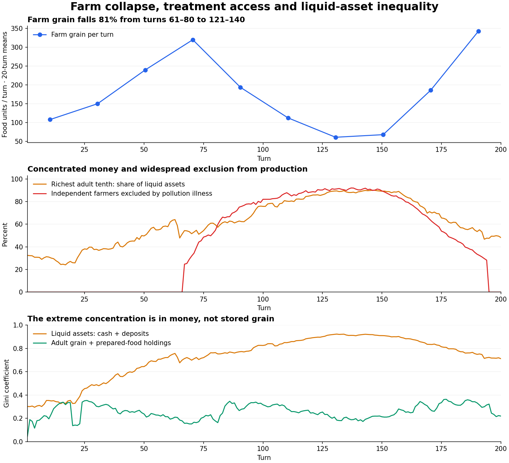

# Foraging, farm collapse and inequality: verified trace review

Date: 2026-11-01. Case: seed 4243 of the accepted 200-turn parish experiment.

The old foraging allowance did make cultivation largely optional for an eligible adult's own basic meal. It did not reliably feed dependents or residents without access. The grain collapse is recorded as a loss of effective farm work, not a loss of farmer headcount. Money inequality amplifies that collapse through unequal access to medical treatment; the trace does not support landlord grain hoarding as its principal explanation.

This report concerns the **frozen October 31 simulation**, not a new run of the subsequently replaced seasonal food model. The replay uses source fingerprint `0c16a014de22e1d033aaefb05c5a5cc124d9bca12c145233d53d352f5b7f8bae` and exactly reproduces every daily observation, opening state, period summary, discovery and campaign event of the accepted untraced run.

## Foraging in the run being analyzed

The rules in the archived `micro/foraging.py` are:

- Eligible: an independent, non-employed person with usable customary commons rights. Native children under 14, landlords, government/corporate entities, traders, constables, military personnel and evicted people without a plot cannot forage through this path.
- Yield: `min(4, max(1, int(8 × effective_access × food_terrain)))` units per eligible person per turn. An effective right of 0.5 on ordinary terrain gives four units.
- Four units equal the ordinary reference adult's 2,000 modeled calories. Gathering four units sets `temporary_work_share = 0.25`.
- No tile-wide harvest limit, depletion or competition for a finite commons stock is applied. More eligible adults produce more total gathered food automatically.
- The allowance is gathered even if the adult already holds food. It is not restricted to a household meal gap.
- Pollution-related illness revolt does not remove foraging eligibility. The farm-production function, however, separately refuses production for these participants.

The result is an unusually favorable subsistence option: a basic adult meal for one quarter of a work turn, with no shared resource constraint. A farmer can then attempt cultivation with the remaining nominal time. That cultivation attempt is also reduced by current inventory, hunger and other constraints. This is a model rule, not an estimate of historical foraging productivity.

Farming is still needed for children, non-foragers, recovery or discretionary appetite, and a transferable surplus. In turns 121–140, gathering supplies 1,245 units per turn, versus approximately 1,355 units of ordinary nutritional demand. Farms add only 61.3 units, and total new supply remains below ordinary need. Thus the old rule masks farm failure without making the entire population food secure.

## Why farm grain fell

These periods span two complete seasonal cycles each, avoiding a winter-versus-harvest comparison:

| Measure | Turns 61–80 | Turns 121–140 |
| --- | ---: | ---: |
| Farm grain per turn | 319.7 | 61.3 |
| Counted farming adults, mean | 180.6 | 293.7 |
| Independent farmer work snapshots excluded by illness revolt | 32.5% | 90.6% |
| Independent farmer snapshots already at inventory cap | 0.08% | 0.07% |

Grain falls **80.8%**, while counted farming adults increase **62.6%**. The low middle-period production is not principally explained by farmers leaving the occupation or filling their stores.

Across the full trace there are 25,010 independent-food zero-output records with reason `pollution_illness_revolt`, 8,811 with `production_random_draw_failed`, and 11 with `worker_strike_withheld_labor`. These are recorded production events, not unique people or a decomposition of potential lost grain. Inventory-full exits can occur before a zero-output trace is emitted; the separate production-boundary replay measures those exits.

The recorded water-pollution inputs are entirely population wastewater: cumulative pre-control `urban_emission` is 1,014.94 index-contribution units, industrial effluent is zero and fertilizer runoff is zero. These are cumulative model inputs, not the closing pollution index. Water pollution first exceeds 20 at turn 48, enabling waterborne infection risk. Food, wood and furniture production have no industrial-water emission contribution in this case.

The illness-policy threshold magnifies the effect. At turn 66, active pollution-associated illness reaches 23.1% of residents, above the 20% revolt threshold. Every qualifying ill adult is placed on the exclusion list. Their farming is then skipped even though they may still gather food. This is much stronger than a proportional reduction in work capacity.

Filtration completes at turn 141 and the sewer at turn 170. Those reduce new exposure, but the old medical routine does not have a spontaneous-recovery branch for existing waterborne cases. At turn 194, prevalence falls to 19.88%; the revolt exclusion switches off despite 68 active cases. That threshold release helps explain the sharp late recovery. It is not evidence that all farmers suddenly became healthy.

## The inequality mechanism is visible in the trace

Private treatment costs 20 cash per disease attempt; ordinary waterborne treatment has an 80% cure chance. Public care is disabled throughout the replay. The affordability branch checks cash, not total asset values. There are no bank deposits sufficient to cover the fee among the cash-poor farmer-patient observations in the central comparison below.

During turns 81–140:

| Sick independent adult farmer observations | Cash below 20 | Cash at least 20 |
| --- | ---: | ---: |
| Farmer-patient turns | 14,991 | 414 |
| Treatment attempts | 0 | 415 |
| Still sick after the care phase | 100% | 19.3% |

These are repeated patient-turn observations, not 15,405 different people. An individual with multiple diseases can receive more than one attempt in a turn. The groups are observational and not matched by age or disease severity. Nevertheless, the recorded cash gate directly establishes that inability to pay prevented treatment; this is stronger evidence than a correlation between a regional Gini and output.

For all residents over the complete campaign, the trace records 813 treatment attempts, 647 successful treatments, zero publicly funded attempts, and 37,249 unaffordable disease-case turns. Of the unaffordable case-turns, 28,665 are waterborne illness. Persistent untreated illness feeds the automatic farm-work exclusion.

### One directly recorded chain: farmer 104

| Turn | Event | Trace event ID |
| --- | --- | --- |
| 77 | Waterborne infection: water pollution 45.66; risk 10.27%; draw 2.06%; not hungry before infection | `foraging-inequality-4243:245551` |
| 77 | Treatment refused: patient cash 0; fee 20; public care unavailable | `foraging-inequality-4243:245988` |
| 77 | Regional illness assessment places this farmer on the revolt-participant list | `foraging-inequality-4243:246149` |
| 78 | Farmer nevertheless gathers four food units using 0.25 of a turn | `foraging-inequality-4243:250760` |
| 78 | Farm output is explicitly zero because of `pollution_illness_revolt`; its inputs identify the preceding assessment | `foraging-inequality-4243:251191` |

This farmer still has zero cash and active waterborne illness in the turn-80, 100, 120 and 140 production-boundary snapshots. The infection starts without prior hunger, so this example is not simply malnutrition relabeled as pollution illness. It demonstrates environmental exposure, inability to pay, persistent illness and the asymmetric work rule in order. The compact payloads are retained in `case_chain.json`; the full records are in `seed_4243.ctr`.

## Where the money and grain went

The following distribution measurements use actual adults: founding residents plus trace-recorded births. Entities created as corporations and later converted into apparent people are excluded. The financial measure is **nonnegative cash plus bank deposits**, not full net worth: no land, corporate equity, inventory valuation or debt subtraction is included. All distributions are measured immediately before production.

| Measure | Turn 1 | Turn 100 | Turn 140 |
| --- | ---: | ---: | ---: |
| Adult liquid-asset Gini | 0.302 | 0.825 | 0.914 |
| Richest approximately 10%: liquid-asset share | 32.5% | 75.8% | 88.6% |
| Adult raw/prepared food-holding Gini | 0.046 | 0.316 | 0.179 |
| Independent farmers below the 20-cash treatment fee | 0/50 | 279/317 | 277/290 |
| Grain held by surviving landlords | 4 | 0 | 0 |

At turn 140, a furniture worker, actor 402, holds 3,233.16 in cash plus deposits: **50.7% of measured adult liquid assets**. This person has no active disease in that snapshot. Over the whole campaign, 402 receives 4,640 in medical fees. Total recorded medical transfers are 16,260; the three largest recipients collect 10,800, or 66.4%.

Medical receipts are cumulative flows and can circulate repeatedly; they are not an additional stock of newly created money. Birth endowments, inheritance, taxes and market trades also move money, so these figures do not assign all inequality to medicine.

The provider-selection rule itself matters: it chooses a matching furniture producer, then a wood producer or another fallback as the medical practitioner. Fees are transferred directly to that actor. There is no separately staffed medical-service production capacity in this routine. That design can concentrate cash among a small set of craft workers while farm households are excluded from care.

Extreme **money** concentration and moderate adult **food-stock** concentration coexist here. The severe production interruption is therefore better explained by unequal medical access and the blanket illness work rule than by landlords sitting on all the grain. This does not establish that every household can reach enough food; adult stock distributions exclude dependent allocation and do not by themselves measure meal access.

## Rules in the newer workspace

The current food model has changed since the archived experiment. Copies of the reviewed current modules and their hashes are retained under `current_source/` and in `current_source_manifest.json`.

- Gathering is now limited by a shared regional commons stock and a seasonal regeneration capacity.
- It supplies the household's current meal gap rather than an unconditional four-unit allowance.
- Work is assigned from a shared budget at eight food units per full work turn. Cultivation, gathering, other work and engineering compete for work time.
- The 70-person region's default nominal commons capacity is 56. With full commons access, seasonal regeneration is approximately 34–56 units per turn, with a separate finite carryover-stock limit of 112. Seventy reference adults need 280 units per turn. At those defaults, foraging cannot replace farming for the whole region.
- Eligibility and work-capacity rules have also been revised. The historical full-meal-for-quarter-turn rule and asymmetric revolt handling must not be assumed to describe a fresh current-model run.

This review does not adjust either model's balance rules. The current numbers above are code inspection, not a new accepted 200-turn outcome.

## Interpretation and next work

The trace supports this mechanism: ample per-person gathering permits rapid population growth; untreated population sewage creates waterborne illness; money-poor farmers cannot buy treatment; persistent illness triggers blanket farm exclusion; the generous gathering path remains open and masks the resulting harvest collapse. Medical payments also channel money toward a small set of providers.

It does **not** quantify how much of the 80.8% grain decline would disappear under redistribution or publicly funded care. That requires a separately authorized intervention comparison, with all other rules and opening resources held fixed. Nor does this one-seed trace establish an optimal commons yield or disease calibration.

The next useful comparison is the newer finite-commons model with its actual work allocations, seed use, food conservation and household access recorded. Medical affordability, explicit healthcare capacity, natural recovery and the intensity of work disruption should be reviewed as distinct mechanisms. Do not eliminate disease or force food and population curves to match to pass the test.

## Verification and artifacts

- A full causal replay produces 1,011,335 logical records and exactly matches the accepted untraced economic outcomes across all 200 turns.
- All ten twenty-turn farm-production totals derived from the trace match the saved production logs exactly.
- The compact trace passes typed-record/digest verification. This diagnostic does not emit turn checkpoints; the separate untraced-result comparison validates the economic replay.
- Zero currency-audit violations; no trace write error. Original acceptance data and frozen source are unchanged.
- `seed_4243.ctr`: full causal trace; `selected_trace.jsonl.gz` and `supplementary_trace.jsonl.gz`: extracted records.
- `boundaries.jsonl.gz`: read-only medical and production boundary observations; `journal.jsonl.gz`: selected settled transfers.
- `analysis.json`: computed distributions, affordability comparisons, zero-output reasons and example chain.
- `capture.py` and `analyze.py`: replay and derivation scripts. `capture_validation.json` and `trace_integrity.json`: verification evidence.

The full 61 MB `seed_4243.ctr` stream is a generated local artifact and is not
versioned. The extracted evidence, boundary observations, settled-transfer
journal, integrity digest and findings are versioned. To regenerate the full
stream, extract `../natural_abundance_200turn_20261031/source_snapshot.tar.gz`
into an empty directory. Set `ABUNDANCE_SOURCE_ROOT` and `PYTHONPATH` to that
directory, `PYTHONHASHSEED=0`, and `MPLCONFIGDIR` to a writable cache, then run
this directory's `capture.py` with the project's Python environment. A preexisting
trace must be moved aside before regenerating; the capture never replaces it.
