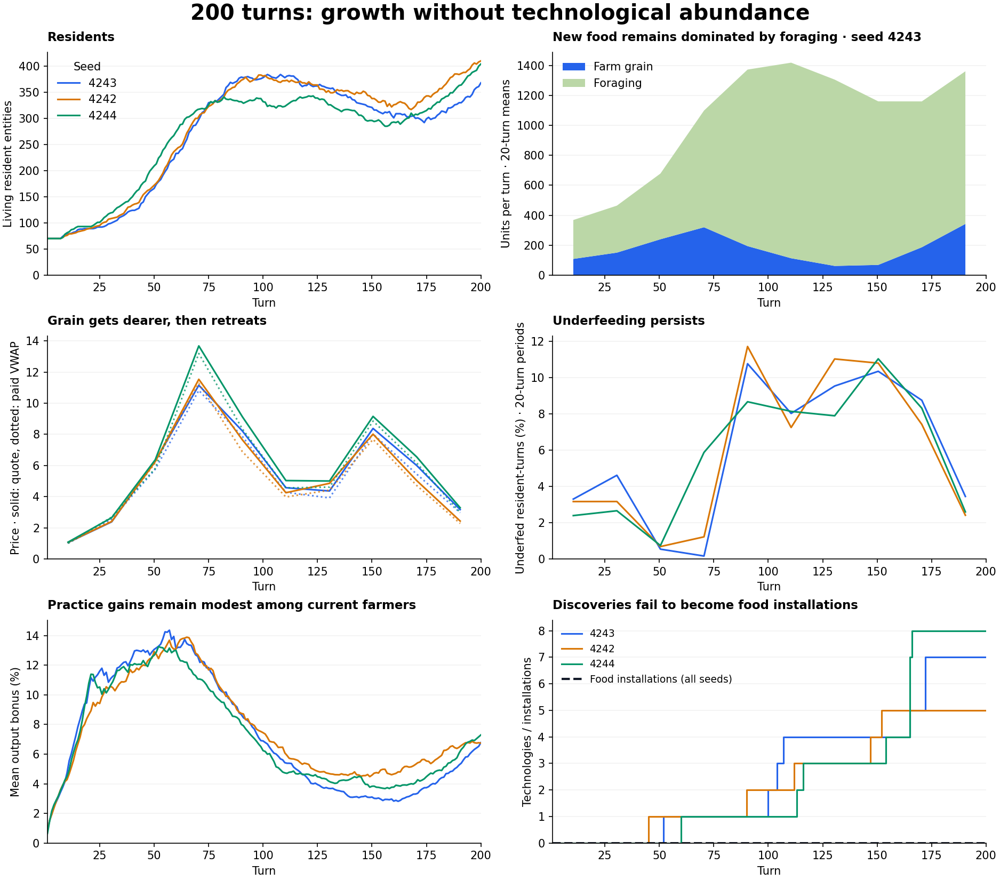

# Natural abundance: 200-turn acceptance test

Date: 2026-10-31. Status: simulations passed accounting checks; the intended abundance progression is **not yet demonstrated**.

Three seeds ran 200 canonical turns each, with national innovation and the normal national AI enabled. The economy grew, but technology discovery never became an operating food installation. Prices ended above their opening level, and foraging still supplied roughly three quarters of new food in the last twenty turns.

## Setup and reproducibility

- Same 70-person feudal parish as the earlier local abundance fixture: 75% food, 15% wood, 10% furniture profession distribution; normal starting inventories and cash.
- No artificial yield boost, granted technologies, preinstalled equipment, extra food, recurring cash, or harness-issued construction orders. Seasonal tribute and finite estate feeding remain enabled. Spoilage remains off.
- A nation and its ordinary AI now participate in every turn. Authored local deposits are arable silt, timber, iron ore and coal: these provide research access, not extracted materials.
- One isolated region, no outside trading partners. Exports, imports and technology diffusion cannot be assessed here.
- Each seed uses a fresh process and `PYTHONHASHSEED=0`.
- Accepted frozen-source fingerprint: `0c16a014de22e1d033aaefb05c5a5cc124d9bca12c145233d53d352f5b7f8bae`. The exact copied source is archived in `source_snapshot.tar.gz`; its runtime path was `/private/tmp/natural-abundance-200turn-20261031-ypso41zf`.
- The original three live-workspace runs each reported unchanged source. New files appeared during a later diagnostic replay, so the accepted matrix was repeated from the frozen copy. All 600 daily observations match the original runs exactly.

## Results

Block averages use turns 1–20 and 181–200, covering complete ten-turn seasonal cycles. Underfeeding is underfed resident-turns divided by total resident-turns. Paid prices are quantity-weighted actual transactions; quotes are posted reference prices.

| Seed | Residents at 200 | Farm grain/turn, opening → ending block | Grain quote, opening → ending block | Ending underfed share | Recorded starvation deaths |
| --- | ---: | ---: | ---: | ---: | ---: |
| 4243 | 368 | 108 → 342 | 1.06 → 3.18 | 3.4% | 3 |
| 4242 | 410 | 102 → 428 | 1.08 → 2.44 | 2.4% | 17 |
| 4244 | 404 | 112 → 390 | 1.09 → 3.29 | 2.6% | 9 |

| Seed | Crop rotation discovered | Known technologies at 200 | Food installations ever | Ending forage share | Paid grain price, opening → ending block |
| --- | ---: | ---: | ---: | ---: | ---: |
| 4243 | 53 | 7 | 0 | 74.9% | 1.03 → 2.98 |
| 4242 | 46 | 5 | 0 | 73.4% | 1.05 → 2.29 |
| 4244 | 61 | 8 | 0 | 74.5% | 1.01 → 2.99 |

## What stopped the progression

Discovery is running. Crop rotation arrives at turns 46, 53 and 61, followed by other agronomy discoveries. Every discovered design remains at tier one; no productive machine work is attributed to installed technologies, and no food production installation is built during any of the three campaigns. Public AI builds roads, a canal, filtration and sewers, which do not directly multiply grain output in these runs.

Deployment has a structural gap for this economy. `economy/technology_adoption.py:step_private_adoption` considers living corporations only. Independent peasants and estate owners have no equivalent automatic adoption path. Its final recorded decisions all report `no_operating_workforce`; these are the latest per-firm/design decisions, not a full history. The observed complete seed-4243 decision history is retained separately.

More farmers do not produce proportionately more market grain. In seed 4243, the ending block has 244 farming adults on average, versus 39 initially, but grain output rises from 108 to 342 units per turn. Its headcount-normalized output falls from 2.79 to 1.40. This is output divided by worker snapshots, not a measurement of output per actual shift. The boundary replay below identifies the immediate production constraints.

| Seed 4243 turns | Farm worker snapshots withheld | Inventory already full | Eligible for production | Successful independent operations / farmer snapshot |
| --- | ---: | ---: | ---: | ---: |
| 1–20 | 0.0% | 3.5% | 96.5% | 0.36 |
| 21–40 | 0.0% | 0.9% | 99.1% | 0.38 |
| 41–60 | 0.0% | 0.0% | 100.0% | 0.44 |
| 61–80 | 32.5% | 0.1% | 67.4% | 0.28 |
| 81–100 | 73.5% | 3.6% | 22.9% | 0.07 |
| 101–120 | 85.5% | 2.0% | 12.5% | 0.04 |
| 121–140 | 90.6% | 0.1% | 9.3% | 0.03 |
| 141–160 | 87.7% | 0.2% | 12.1% | 0.04 |
| 161–180 | 63.2% | 5.6% | 31.1% | 0.09 |
| 181–200 | 25.4% | 15.1% | 59.6% | 0.17 |

The dominant measured mid-campaign work blockage is pollution-related illness revolt, rather than ordinary wage strikes or full inventories. In turns 121–140, about 90.6% of independent farm-worker snapshots are on the pollution-revolt exclusion list; ordinary strikes account for about 0.02%, with possible overlap. Their farm production is skipped, while the separate commons-foraging eligibility rule remains open. Grain production in this block averages just 61 units per turn despite nearly 294 counted farming adults. This is an immediate code-path explanation of withheld output, not proof that any single pollution parameter caused the entire long-run result. The normal AI eventually builds filtration and sewer works, but the interruption is already substantial.

Current farmers end with only about a 7% average practice bonus. The potential +60% cap is not an automatic gain over elapsed time: only successful productive work earns practice, reduced by work allocated elsewhere. Population turnover also matters: the model ages residents by one year each turn, so a 200-turn campaign spans many generations. This test does not isolate their separate causal effects.

The economy has not diversified into sustained surplus processing. Prepared-food output in the opening versus ending twenty-turn blocks is 322 → 0 for seed 4243, 313 → 48 for 4242, and 251 → 9 for 4244. Prepared meals reuse grain calories and are not added to new grain and forage supply. Roughly 94–97% of the counted civilian production workforce is farming at turn 200. Neither more corporation entities nor more discovered designs is evidence of an operating industrial economy.

## Verification and limits

- All three frozen cases completed 200 turns at one unchanged source fingerprint, with zero reported currency-accounting violations and zero negative inventory failures.
- A separate, read-only seed-4243 replay observes production and adoption boundaries. Its full daily economic observations, events, discoveries, latest adoption reasons and opening state match the unobserved run exactly.
- This is an observational acceptance test, not a matched innovation-on/off experiment. Changes in population, soil, weather, policy, food access and workforce composition prevent attributing output changes to any one mechanism.
- Counts exclude government and corporation entities, but existing person-to-company conversions can affect resident counts and death counters. Reported starvation deaths are engine counters, not an independently reconstructed mortality cohort.
- A low quoted price or an ending stockpile alone cannot establish affordable meals, broad prosperity or successful technology deployment.

## Next implementation target

Two mechanisms need attention before claiming the abundance progression. First, review whether pollution-illness revolt should prevent subsistence farming this broadly, and whether sanitation and recovery act soon enough. Second, provide an adoption path for actual agricultural producers: independent farmers, estate owners and operating farm businesses. Cheap agronomic practices need suitable costs and local learning; machinery needs financed equipment, materials and labor. Keep discovery, adoption, actual use and refinement separately observable. Repeat this matrix after those changes, before adding spoilage or claiming successful surplus-driven diversification.

## Files and rerun

- `frozen/seed_4243.json`, `seed_4242.json`, `seed_4244.json`: daily observations and twenty-turn summaries.
- `frozen/seed_4243_constraints.json`: production-boundary observations and complete adoption decision history.
- `summary.json`: validated cross-seed results.
- `snapshot_manifest.json` and `source_snapshot.tar.gz`: fixed source provenance.
- `scripts/audit_natural_abundance.py`: reusable harness in the workspace and frozen archive.
- `inspect_constraints.py` and `build_report.py`: diagnostic replay and report rendering.

Extract the source archive into an empty directory and run its harness in a fresh process per seed with the project virtual environment. Set `PYTHONPATH` to that extracted directory, `PYTHONHASHSEED=0`, and `MPLCONFIGDIR` to a writable cache. Use `--turns 200 --seed 4243 --output <result.json>`. Repeat for seeds 4242 and 4244. The diagnostic script accepts `ABUNDANCE_SOURCE_ROOT` and `ABUNDANCE_REPORT_ROOT` to locate the extracted source and accepted results.
